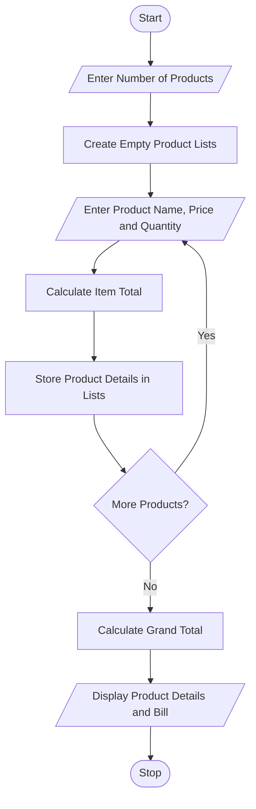

# Case 10 – Online Shopping Billing System

## 1. AIM
To develop a Python program for an Online Shopping Billing System using Lists, Loops, and Calculations to store product details and calculate the total shopping bill.

## 2. INPUT
- `int_count` – Number of products.
- `str_product_name` – Product name.
- `float_product_price` – Price of each product.
- `int_quantity` – Quantity of each product.
- `float_item_total` – Total price of each product.
- `float_grand_total` – Final shopping bill.

## 3. PROCESS
1. Read the number of products.
2. Create lists to store product names, prices, quantities, and totals.
3. Use a for loop to collect product details.
4. Calculate each product total by multiplying price and quantity.
5. Store the details in their respective lists.
6. Calculate the grand total using the `sum()` function.
7. Display all product details.
8. Display the final shopping bill.

## 4. OUTPUT
- Product names.
- Product prices.
- Product quantities.
- Individual product totals.
- Grand total bill.
- Thank you message.

## 5. ALGORITHM
1. Start.
2. Read the number of products.
3. Create four empty lists.
4. Repeat the following steps for each product:
   - Read product name.
   - Read product price.
   - Read product quantity.
   - Calculate item total.
   - Store details in lists.
5. Calculate the grand total.
6. Display all product details.
7. Display the grand total.
8. Display the thank you message.
9. Stop.

## 6. PSEUDOCODE

```text
BEGIN

    INPUT int_count

    CREATE empty product lists

    FOR each product FROM 1 TO int_count

        INPUT str_product_name
        INPUT float_product_price
        INPUT int_quantity

        CALCULATE float_item_total
        STORE product details in lists

    END FOR

    CALCULATE float_grand_total

    FOR each product FROM 1 TO int_count

        DISPLAY product name
        DISPLAY product price
        DISPLAY quantity
        DISPLAY item total

    END FOR

    DISPLAY float_grand_total
    DISPLAY thank you message

END
```

## 7. FLOWCHART



## 8. SAMPLE INPUT

```text
Enter number of products: 2

Product 1
Enter product name: Shirt
Enter product price: 500
Enter quantity: 2

Product 2
Enter product name: Shoes
Enter product price: 1000
Enter quantity: 1
```

## 9. SAMPLE OUTPUT

```text
====== ONLINE SHOPPING BILL ======

Product: Shirt
Price: 500.0
Quantity: 2
Total: 1000.0
----------------------------

Product: Shoes
Price: 1000.0
Quantity: 1
Total: 1000.0
----------------------------

Grand Total: Rs. 2000.0
Thank you for shopping!
```

## 10. CONCLUSION

Thus, the Online Shopping Billing System was successfully developed using Python Lists, Loops, and Calculations to store product details and generate the final shopping bill.
