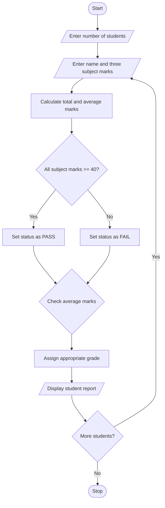

# Case Study 2 – Student Performance Analysis

## 1. Aim

To develop a Python program to analyze student performance by calculating total marks, average marks, assigning grades, and identifying pass or fail status.

## 2. INPUT

- Number of students.
- Student name.
- Marks in three subjects.

## 3. PROCESS

- Accept student details.
- Calculate total marks.
- Calculate average marks.
- Check pass or fail status.
- Assign grades based on average marks.
- Display the performance report.

## 4. OUTPUT

- Student name.
- Total marks.
- Average marks.
- Grade.
- Pass or fail status.

## 5. Algorithm

1. Start.
2. Enter the number of students.
3. Enter the student name.
4. Enter marks in three subjects.
5. Calculate total marks.
6. Calculate average marks.
7. Check whether the student scored at least 40 marks in every subject.
8. If all subjects have at least 40 marks, declare PASS; otherwise, declare FAIL.
9. Assign a grade based on average marks.
10. Display the student performance report.
11. Repeat for all students.
12. Stop.

## 6. Pseudocode

BEGIN

    READ int_students

    FOR each student

        READ str_name

        READ int_mark1
        READ int_mark2
        READ int_mark3

        SET int_total = int_mark1 + int_mark2 + int_mark3

        SET float_average = int_total / 3

        IF all subject marks >= 40 THEN
            SET str_status = "PASS"
        ELSE
            SET str_status = "FAIL"
        END IF

        IF float_average >= 80 THEN
            SET str_grade = "A"
        ELSE IF float_average >= 70 THEN
            SET str_grade = "B"
        ELSE IF float_average >= 60 THEN
            SET str_grade = "C"
        ELSE IF float_average >= 50 THEN
            SET str_grade = "D"
        ELSE
            SET str_grade = "E"
        END IF

        DISPLAY student performance report

    END FOR

END

## 7. Flowchart

## 8. Sample

INPUT:

Number of students: 2

Student 1:
Name: Ravi
Subject 1: 85
Subject 2: 90
Subject 3: 80

Student 2:
Name: Priya
Subject 1: 35
Subject 2: 60
Subject 3: 55

OUTPUT:

STUDENT PERFORMANCE REPORT

Student Name: Ravi
Total Marks: 255
Average Marks: 85.0
Grade: A
Status: PASS

Student Name: Priya
Total Marks: 150
Average Marks: 50.0
Grade: D
Status: FAIL

## 9. Conclusion

The Student Performance Analysis System was successfully developed using Python. It calculates total and average marks, assigns grades, and identifies students' pass or fail status.
