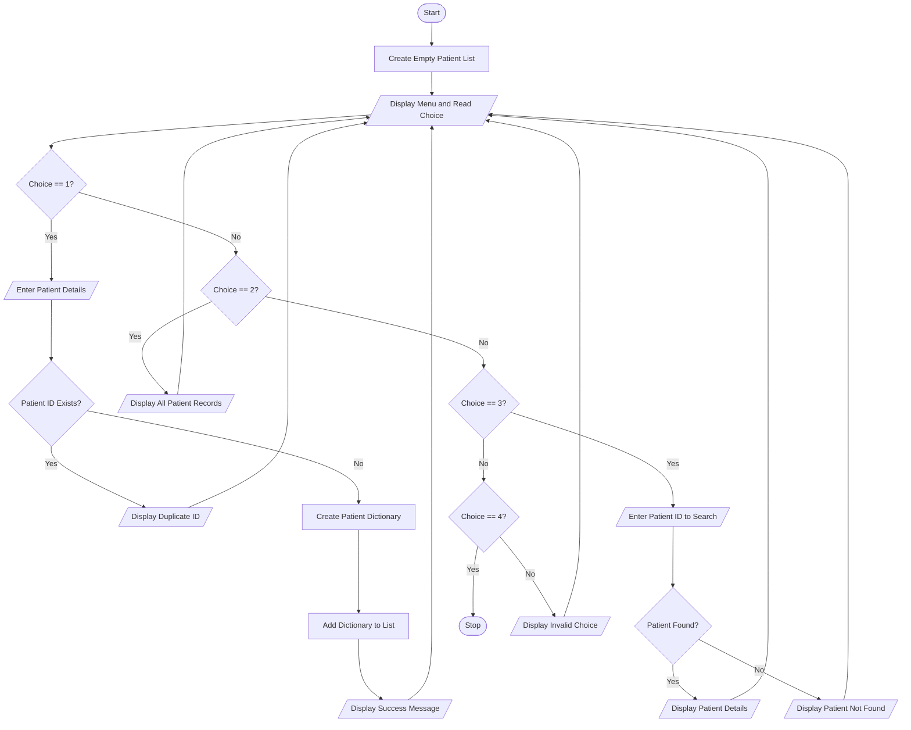

# Case 4 – Hospital Patient Management

## 1. AIM
To develop a Python program for Hospital Patient Management using Dictionaries and Lists to add, display, and search patient details.

## 2. INPUT
- `int_choice` – Menu choice.
- `str_patient_id` – Patient ID.
- `str_name` – Patient name.
- `int_age` – Patient age.
- `str_disease` – Patient disease.
- `str_search_id` – Patient ID to search.

## 3. PROCESS
1. Create an empty list to store patient records.
2. Display the menu options.
3. Accept patient details from the user.
4. Store patient details in a dictionary.
5. Add the dictionary to the patient list.
6. Display all patient records.
7. Search for a patient using patient ID.
8. Exit the program when the user selects option 4.

## 4. OUTPUT
- Patient added successfully.
- Display all patient records.
- Display searched patient details.
- Display patient not found if the ID does not exist.
- Display exit message.

## 5. ALGORITHM
1. Start.
2. Create an empty patient list.
3. Display the menu.
4. Read the user's choice.
5. If choice is 1, enter patient details.
6. Check whether the patient ID already exists.
7. If not, create a dictionary and add it to the list.
8. If choice is 2, display all patient records.
9. If choice is 3, search for a patient using ID.
10. If the patient is found, display patient details.
11. Otherwise, display patient not found.
12. If choice is 4, exit the program.
13. Repeat until the user selects Exit.
14. Stop.

## 6. PSEUDOCODE

```text
BEGIN
    CREATE empty list_patients

    REPEAT
        DISPLAY menu
        INPUT int_choice

        IF int_choice == 1 THEN
            INPUT str_patient_id

            CHECK whether patient ID exists

            IF ID does not exist THEN
                INPUT str_name
                INPUT int_age
                INPUT str_disease

                CREATE dict_patient
                ADD dict_patient TO list_patients
                DISPLAY success message
            ELSE
                DISPLAY duplicate ID message
            END IF

        ELSE IF int_choice == 2 THEN
            DISPLAY all patient records

        ELSE IF int_choice == 3 THEN
            INPUT str_search_id
            SEARCH patient list

            IF patient found THEN
                DISPLAY patient details
            ELSE
                DISPLAY patient not found
            END IF

        ELSE IF int_choice == 4 THEN
            DISPLAY exit message

        ELSE
            DISPLAY invalid choice
        END IF

    UNTIL int_choice == 4

END
```

## 7. FLOWCHART



## 8. SAMPLE INPUT

```text
Enter your choice: 1
Enter patient ID: P101
Enter patient name: Ravi
Enter patient age: 25
Enter disease: Fever

Enter your choice: 2
```

## 9. SAMPLE OUTPUT

```text
Patient added successfully.

--- Patient Records ---
Patient ID: P101
Name: Ravi
Age: 25
Disease: Fever
----------------------

Enter your choice: 3
Enter patient ID to search: P101

Patient Found
Patient ID: P101
Name: Ravi
Age: 25
Disease: Fever

Enter your choice: 4
Thank you. Exiting the program.
```

## 10. CONCLUSION

Thus, the Hospital Patient Management program was successfully developed using Python Dictionaries and Lists to add, display, and search patient records.
