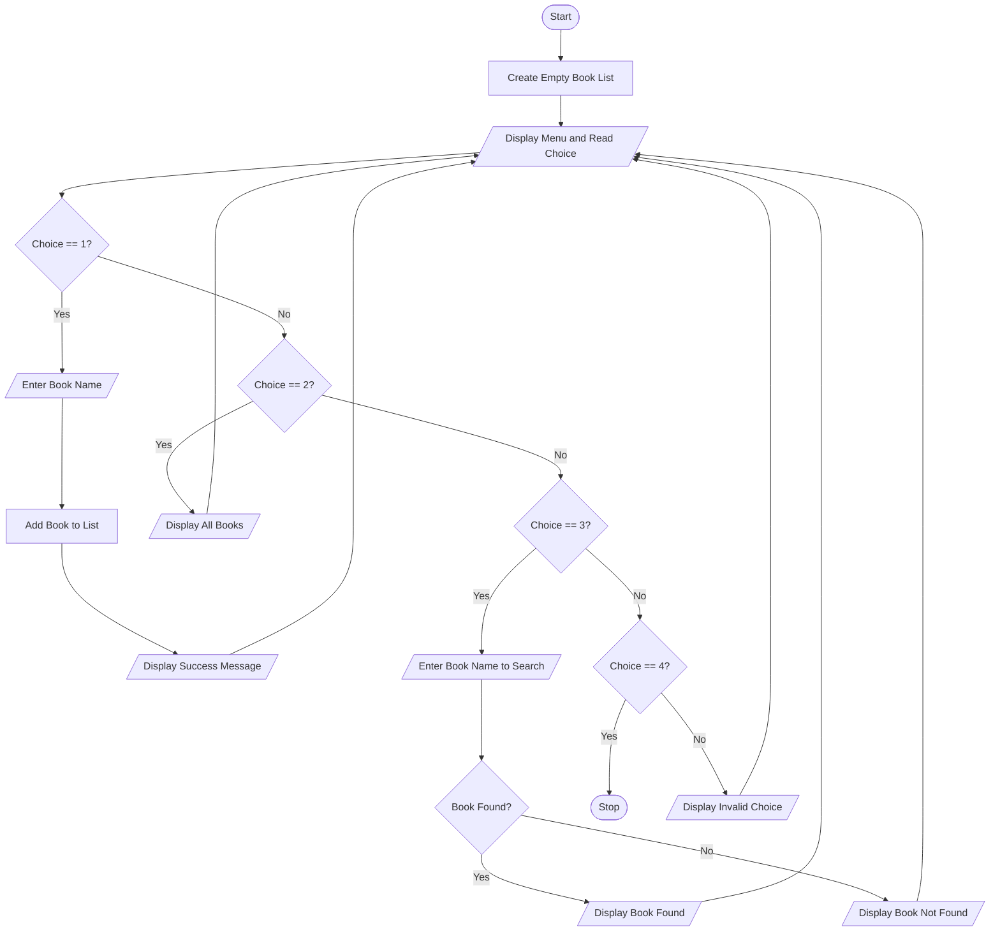

# Case 5 – Library Book Tracking System

## 1. AIM
To develop a Python program for Library Book Tracking System using Lists and Searching to add, display, and search for books.

## 2. INPUT
- `int_choice` – Menu choice.
- `str_book` – Book name.
- `str_search_book` – Book name to search.

## 3. PROCESS
1. Create an empty list to store book names.
2. Display the menu options.
3. Accept the user's choice.
4. Add book names to the list.
5. Display all available books.
6. Search for a book using its name.
7. Exit the program when the user selects option 4.

## 4. OUTPUT
- Book added successfully.
- Display all available books.
- Display book found or book not found.
- Display exit message.

## 5. ALGORITHM
1. Start.
2. Create an empty list named `list_books`.
3. Display the menu.
4. Read the user's choice.
5. If choice is 1, enter a book name and add it to the list.
6. If choice is 2, display all available books.
7. If choice is 3, enter a book name and search in the list.
8. If the book is found, display the book name.
9. Otherwise, display book not found.
10. If choice is 4, exit the program.
11. Repeat until the user selects Exit.
12. Stop.

## 6. PSEUDOCODE

```text
BEGIN
    CREATE empty list_books

    REPEAT
        DISPLAY menu
        INPUT int_choice

        IF int_choice == 1 THEN
            INPUT str_book
            ADD str_book TO list_books
            DISPLAY success message

        ELSE IF int_choice == 2 THEN
            DISPLAY all books

        ELSE IF int_choice == 3 THEN
            INPUT str_search_book
            SEARCH for the book in list_books

            IF book is found THEN
                DISPLAY book found
            ELSE
                DISPLAY book not found
            END IF

        ELSE IF int_choice == 4 THEN
            DISPLAY exit message

        ELSE
            DISPLAY invalid choice
        END IF

    UNTIL int_choice == 4

END
```

## 7. FLOWCHART



## 8. SAMPLE INPUT

```text
Enter your choice: 1
Enter book name: Python Programming

Enter your choice: 1
Enter book name: Data Structures

Enter your choice: 2
```

## 9. SAMPLE OUTPUT

```text
Book added successfully.

Book added successfully.

Available Books:
1. Python Programming
2. Data Structures

Enter your choice: 3
Enter book name to search: Python Programming

Book found: Python Programming

Enter your choice: 4
Thank you. Exiting the program.
```

## 10. CONCLUSION

Thus, the Library Book Tracking System was successfully developed using Python Lists and Searching concepts to add, display, and search book records.
