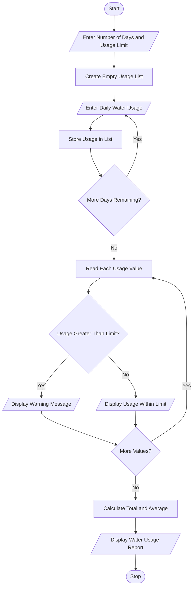

# Case 6 – Smart Water Usage Monitoring

## 1. AIM
To develop a Python program for Smart Water Usage Monitoring using Loops and Conditions to monitor daily water consumption and identify excess usage.

## 2. INPUT
- `int_days` – Number of days.
- `float_limit` – Daily water usage limit in litres.
- `float_usage` – Daily water consumption.
- `list_water_usage` – List of daily water usage values.

## 3. PROCESS
1. Read the number of days.
2. Read the daily water usage limit.
3. Use a loop to collect daily water consumption.
4. Store the values in a list.
5. Compare each day's usage with the given limit.
6. Display a warning if usage exceeds the limit.
7. Calculate total and average water usage.
8. Display the water usage report.

## 4. OUTPUT
- Daily water consumption details.
- Warning message for excess water usage.
- Total water consumption.
- Average daily water consumption.
- Monitoring completed message.

## 5. ALGORITHM
1. Start.
2. Read the number of days.
3. Read the daily water usage limit.
4. Create an empty list.
5. Repeat for the given number of days.
6. Read daily water usage.
7. Add the usage to the list.
8. Display each day's water usage.
9. Check whether usage exceeds the limit.
10. If yes, display a warning message.
11. Otherwise, display usage within the limit.
12. Calculate total water usage.
13. Calculate average water usage.
14. Display the results.
15. Stop.

## 6. PSEUDOCODE

```text
BEGIN
    INPUT int_days
    INPUT float_limit
    CREATE empty list_water_usage

    FOR each day FROM 1 TO int_days
        INPUT float_usage
        ADD float_usage TO list_water_usage
    END FOR

    FOR each float_usage IN list_water_usage
        DISPLAY float_usage

        IF float_usage > float_limit THEN
            DISPLAY "Warning: Usage exceeded the limit"
        ELSE
            DISPLAY "Usage is within the limit"
        END IF
    END FOR

    CALCULATE total water usage
    CALCULATE average water usage

    DISPLAY total water usage
    DISPLAY average water usage
END
```

## 7. FLOWCHART



## 8. SAMPLE INPUT

```text
Enter number of days: 3
Enter daily water usage limit in litres: 100

Enter water usage for day 1: 80
Enter water usage for day 2: 120
Enter water usage for day 3: 90
```

## 9. SAMPLE OUTPUT

```text
--- Water Usage Report ---

Day 1 : 80.0 litres
Water usage is within the limit.

Day 2 : 120.0 litres
Warning: Water usage exceeded the limit!

Day 3 : 90.0 litres
Water usage is within the limit.

Total Water Usage: 290.0 litres
Average Daily Usage: 96.66666666666667 litres

Monitoring completed.
```

## 10. CONCLUSION

Thus, the Smart Water Usage Monitoring program was successfully developed using Python Loops and Conditions to monitor daily water consumption and identify excess water usage.
