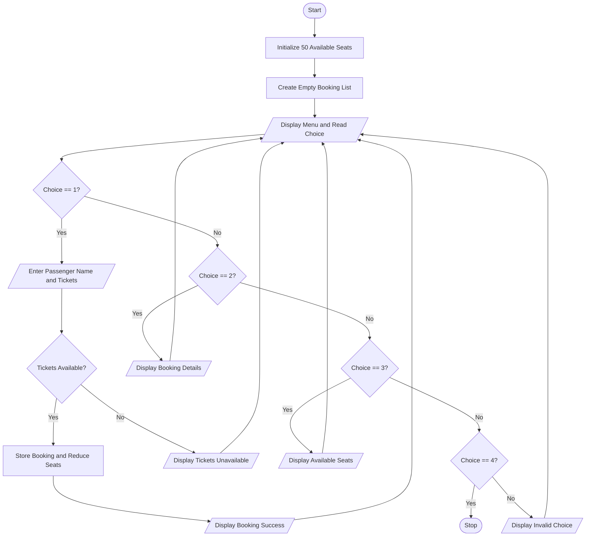

# Case 7 – Railway Ticket Reservation

## 1. AIM
To develop a Python program for Railway Ticket Reservation using Functions and Conditions to book tickets, display booking details, and check available seats.

## 2. INPUT
- `int_choice` – Menu choice.
- `str_name` – Passenger name.
- `int_tickets` – Number of tickets required.
- `int_available_seats` – Number of available seats.
- `list_bookings` – List of passenger booking records.

## 3. PROCESS
1. Initialize the available seats to 50.
2. Display the menu options.
3. Accept the user's choice.
4. Use a function to book tickets.
5. Check whether the requested tickets are available.
6. Store passenger details in a dictionary.
7. Add the booking to the list.
8. Reduce the available seats.
9. Display booking details when requested.
10. Exit the program when the user selects option 4.

## 4. OUTPUT
- Ticket booking confirmation.
- Passenger booking details.
- Available seat count.
- Message when tickets are unavailable.
- Exit message.

## 5. ALGORITHM
1. Start.
2. Initialize available seats to 50.
3. Create an empty booking list.
4. Display the menu.
5. Read the user's choice.
6. If choice is 1, call the booking function.
7. Enter passenger name and number of tickets.
8. Check whether the requested tickets are available.
9. If available, store the booking and reduce available seats.
10. Otherwise, display tickets unavailable.
11. If choice is 2, display all booking details.
12. If choice is 3, display available seats.
13. If choice is 4, exit the program.
14. Otherwise, display invalid choice.
15. Repeat until the user exits.
16. Stop.

## 6. PSEUDOCODE

```text
BEGIN
    SET int_available_seats = 50
    CREATE empty list_bookings

    DEFINE book_ticket()
        INPUT str_name
        INPUT int_tickets

        IF int_tickets > 0 AND int_tickets <= int_available_seats THEN
            CREATE booking dictionary
            ADD booking TO list_bookings
            REDUCE available seats
            DISPLAY booking success
        ELSE
            DISPLAY tickets unavailable
        END IF
    END FUNCTION

    DEFINE display_bookings()
        IF list_bookings is empty THEN
            DISPLAY no bookings available
        ELSE
            DISPLAY all booking details
        END IF
        DISPLAY available seats
    END FUNCTION

    REPEAT
        DISPLAY menu
        INPUT int_choice

        IF int_choice == 1 THEN
            CALL book_ticket()

        ELSE IF int_choice == 2 THEN
            CALL display_bookings()

        ELSE IF int_choice == 3 THEN
            DISPLAY available seats

        ELSE IF int_choice == 4 THEN
            DISPLAY exit message

        ELSE
            DISPLAY invalid choice
        END IF

    UNTIL int_choice == 4
END
```

## 7. FLOWCHART



## 8. SAMPLE INPUT

```text
Enter your choice: 1
Enter passenger name: Ravi
Enter number of tickets: 2

Enter your choice: 2
```

## 9. SAMPLE OUTPUT

```text
--- Railway Ticket Reservation ---
1. Book Ticket
2. View Bookings
3. Check Available Seats
4. Exit

Ticket booked successfully!

--- Booking Details ---
Passenger Name: Ravi
Tickets: 2
Available Seats: 48

Enter your choice: 3
Available Seats: 48

Enter your choice: 4
Thank you for using Railway Reservation System.
```

## 10. CONCLUSION

Thus, the Railway Ticket Reservation program was successfully developed using Python Functions and Conditions to book tickets, display passenger details, and check available seats.
