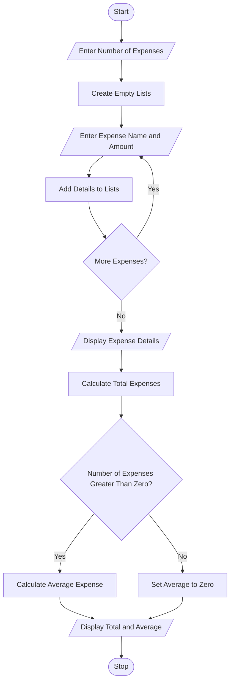

# Case 8 – Personal Expense Tracker

## 1. AIM
To develop a Python program for Personal Expense Tracking using Lists and Calculations to store daily expenses and calculate total and average expenses.

## 2. INPUT
- `int_count` – Number of expenses.
- `str_name` – Expense name.
- `float_amount` – Expense amount.
- `list_expenses` – List of expense names.
- `list_amounts` – List of expense amounts.

## 3. PROCESS
1. Read the number of expenses.
2. Create two empty lists.
3. Get expense names and amounts from the user.
4. Store the names and amounts in separate lists.
5. Display all expense details.
6. Calculate the total expenses using the sum() function.
7. Calculate the average expense.
8. Display the total and average expenses.

## 4. OUTPUT
- Display all expense names and amounts.
- Display total expenses.
- Display average expenses.
- Display expense tracking completed message.

## 5. ALGORITHM
1. Start.
2. Read the number of expenses.
3. Create empty lists for expense names and amounts.
4. Repeat the following steps for the given number of expenses.
5. Enter the expense name and amount.
6. Add the name and amount to their respective lists.
7. Display all expense details.
8. Calculate the total expenses.
9. Check whether the number of expenses is greater than zero.
10. If yes, calculate the average expense.
11. Otherwise, set the average to zero.
12. Display total and average expenses.
13. Stop.

## 6. PSEUDOCODE

```text
BEGIN
    INPUT int_count

    CREATE empty list_expenses
    CREATE empty list_amounts

    FOR each expense FROM 1 TO int_count
        INPUT str_name
        INPUT float_amount

        ADD str_name TO list_expenses
        ADD float_amount TO list_amounts
    END FOR

    DISPLAY all expense details

    CALCULATE float_total

    IF int_count > 0 THEN
        CALCULATE float_average
    ELSE
        SET float_average = 0
    END IF

    DISPLAY float_total
    DISPLAY float_average

END
```

## 7. FLOWCHART



## 8. SAMPLE INPUT

```text
Enter number of expenses: 3

Enter expense name: Food
Enter expense amount: 150

Enter expense name: Travel
Enter expense amount: 100

Enter expense name: Books
Enter expense amount: 250
```

## 9. SAMPLE OUTPUT

```text
--- Personal Expense Report ---

Food : 150.0
Travel : 100.0
Books : 250.0

Total Expenses: 500.0
Average Expense: 166.66666666666666

Expense tracking completed.
```

## 10. CONCLUSION

Thus, the Personal Expense Tracker program was successfully developed using Python Lists and Calculations to store expenses and calculate total and average expenses.
