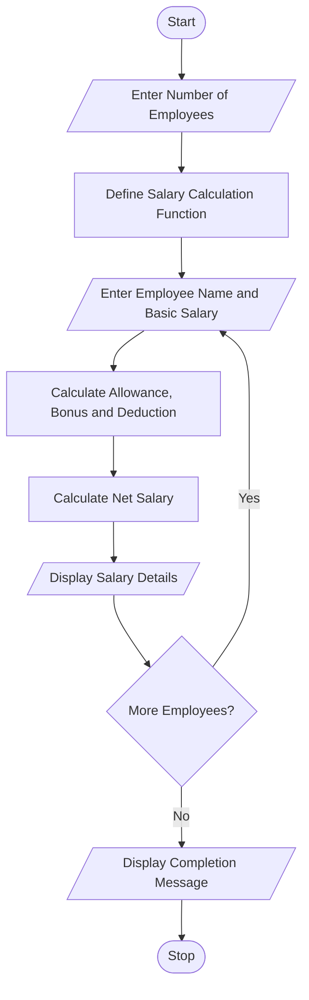

# Case 9 – Employee Salary Management

## 1. AIM
To develop a Python program for Employee Salary Management using Functions and Operators to calculate employee allowances, bonus, deductions, and net salary.

## 2. INPUT
- `int_count` – Number of employees.
- `str_name` – Employee name.
- `float_basic` – Basic salary.
- `float_allowance` – Employee allowance.
- `float_bonus` – Employee bonus.
- `float_deduction` – Salary deduction.
- `float_net_salary` – Final salary.

## 3. PROCESS
1. Read the number of employees.
2. Define a function to calculate salary details.
3. Get employee name and basic salary.
4. Calculate allowance as 20% of basic salary.
5. Calculate bonus as 10% of basic salary.
6. Calculate deduction as 5% of basic salary.
7. Calculate net salary using arithmetic operators.
8. Display employee salary details.
9. Repeat the process for all employees.

## 4. OUTPUT
- Employee name.
- Basic salary.
- Allowance amount.
- Bonus amount.
- Deduction amount.
- Net salary.
- Salary calculation completed message.

## 5. ALGORITHM
1. Start.
2. Read the number of employees.
3. Define the salary calculation function.
4. Calculate allowance as 20% of basic salary.
5. Calculate bonus as 10% of basic salary.
6. Calculate deduction as 5% of basic salary.
7. Calculate net salary.
8. Return the calculated values.
9. Define the display salary function.
10. Read employee name and basic salary.
11. Call the salary calculation function.
12. Display all salary details.
13. Repeat for the given number of employees.
14. Display completion message.
15. Stop.

## 6. PSEUDOCODE

```text
BEGIN
    INPUT int_count

    DEFINE calculate_salary(float_basic)

        CALCULATE float_allowance = 20% of basic salary
        CALCULATE float_bonus = 10% of basic salary
        CALCULATE float_deduction = 5% of basic salary

        CALCULATE float_net_salary
        RETURN all salary values

    END FUNCTION

    FOR each employee FROM 1 TO int_count

        INPUT str_name
        INPUT float_basic

        CALL calculate_salary(float_basic)

        DISPLAY employee name
        DISPLAY basic salary
        DISPLAY allowance
        DISPLAY bonus
        DISPLAY deduction
        DISPLAY net salary

    END FOR

    DISPLAY salary calculation completed

END
```

## 7. FLOWCHART



## 8. SAMPLE INPUT

```text
Enter number of employees: 2

Employee 1
Enter employee name: Ravi
Enter basic salary: 20000

Employee 2
Enter employee name: Priya
Enter basic salary: 30000
```

## 9. SAMPLE OUTPUT

```text
--- Employee Salary Details ---
Employee Name: Ravi
Basic Salary: 20000.0
Allowance: 4000.0
Bonus: 2000.0
Deduction: 1000.0
Net Salary: 25000.0

--- Employee Salary Details ---
Employee Name: Priya
Basic Salary: 30000.0
Allowance: 6000.0
Bonus: 3000.0
Deduction: 1500.0
Net Salary: 37500.0

Salary calculation completed.
```

## 10. CONCLUSION

Thus, the Employee Salary Management program was successfully developed using Python Functions and Operators to calculate employee salary details.
